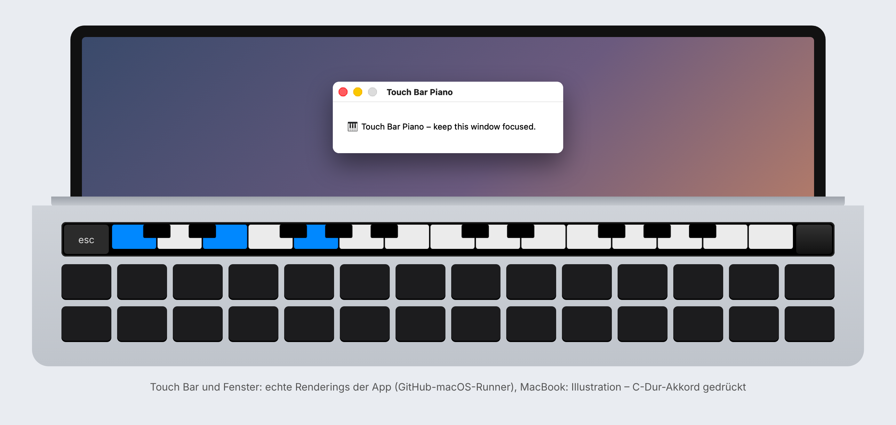

# 🎹 Touch Bar Piano

Verwandelt die Touch Bar des MacBook Pro in ein Klavier mit 2 Oktaven.


<sub>Touch Bar und Fenster sind echte Renderings der App (auf einem GitHub-macOS-Runner via `PIANO_SNAPSHOT` erzeugt), das MacBook drumherum ist eine Illustration.</sub>

## Features
- **2 Oktaven** (C4–C6): 15 weisse + 10 schwarze Tasten
- **Multitouch** – Akkorde spielen, über die Tasten gleiten wechselt den Ton
- **Echter Piano-Klang** aus der eingebauten macOS-Soundbank, keine Zusatzdateien
- **Universal** – Intel und Apple Silicon, ab macOS 10.15
- Eine Datei Swift (~130 Zeilen), kein Xcode-Projekt

## Installation
1. **[Piano.app.zip herunterladen](../../releases/latest/download/Piano.app.zip)** und entpacken
2. Im Terminal (die App ist nicht von Apple signiert):
   ```sh
   xattr -dr com.apple.quarantine Piano.app
   open Piano.app
   ```
3. Für volle Breite: **Systemeinstellungen → Tastatur → Touch Bar → „App-Steuerelemente“**, *Control Strip* aus.

Die Klaviertasten erscheinen, solange das Fenster „Touch Bar Piano“ im Vordergrund ist.

## Wie es funktioniert
| Teil | Technik |
|---|---|
| Touch Bar | `NSTouchBar` + eigene `NSView` mit `allowedTouchTypes = .direct` (öffentliche API) |
| Ton | `AVAudioEngine` + `AVAudioUnitSampler` mit `gs_instruments.dls` (General MIDI) |
| Build | `build.sh` → `swiftc` für x86_64 + arm64 → `lipo` → `.app` |
| Release | GitHub Actions baut bei jedem Push; neue `VERSION` → neues Release |

## Selbst bauen
```sh
./build.sh      # braucht Xcode Command Line Tools
open Piano.app
```

## Neue Version veröffentlichen
`VERSION` ändern (z. B. `v2`), committen, pushen – der Workflow erstellt Tag + Release automatisch.
