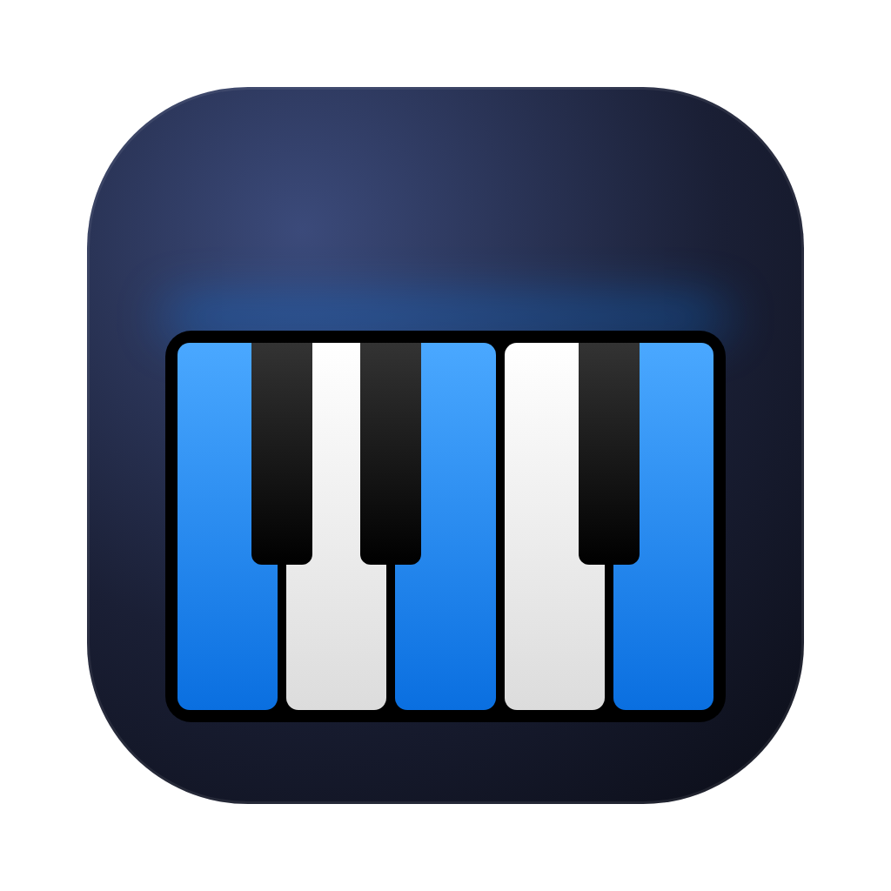

# Touch Bar Piano

Verwandelt die Touch Bar des MacBook Pro in ein Klavier mit 2 Oktaven.


<sub>Touch Bar und Fenster sind echte Renderings der App (auf einem GitHub-macOS-Runner via `PIANO_SNAPSHOT` erzeugt), das MacBook drumherum ist eine Illustration.</sub>

## Features
- **2 Oktaven** auf der Touch Bar, mit Notennamen (C D E F G A H, jedes C mit Oktave)
- **Multitouch** – Akkorde spielen, über die Tasten gleiten wechselt den Ton
- **Pedal** – Shift halten = Haltepedal wie am Klavier
- **Oktave umschalten** – C1 bis C9
- **8 Instrumente** – Piano, E-Piano, Orgel, Gitarre, Streicher, Synth, Vibraphon, Harfe
- **Metronom** – 40–240 BPM, betonte Eins
- Klang aus der eingebauten macOS-Soundbank, keine Zusatzdateien
- **Universal** – Intel und Apple Silicon, ab macOS 10.15

## Tasten
| Taste | Funktion |
|---|---|
| ← → | Oktave wechseln |
| Shift (halten) | Pedal |
| 1 – 8 | Instrument |
| M | Metronom an/aus |
| ↑ ↓ | Tempo ±5 BPM |

Alles wird im App-Fenster angezeigt.

## Installation
1. **[Piano.app.zip herunterladen](../../releases/latest/download/Piano.app.zip)** und entpacken
2. Im Terminal (die App ist nicht von Apple signiert):
   ```sh
   xattr -dr com.apple.quarantine Piano.app
   open Piano.app
   ```
3. Für volle Breite: **Systemeinstellungen → Tastatur → Touch Bar → „App-Steuerelemente“**, *Control Strip* aus.

Die Klaviertasten erscheinen, solange das Fenster „Touch Bar Piano“ im Vordergrund ist.

## Wie es funktioniert
| Teil | Technik |
|---|---|
| Touch Bar | `NSTouchBar` + eigene `NSView` mit `allowedTouchTypes = .direct` (öffentliche API) |
| Ton | `AVAudioEngine` + `AVAudioUnitSampler` mit `gs_instruments.dls` (General MIDI) |
| Pedal | MIDI Control Change 64 (Sustain) |
| Metronom | zweiter Sampler mit der Percussion-Bank (Woodblock) |
| Build | `build.sh` → `swiftc` für x86_64 + arm64 → `lipo` → `.app` mit Icon |
| Release | GitHub Actions baut bei jedem Push; neue `VERSION` → neues Release |

## Selbst bauen
```sh
./build.sh      # braucht Xcode Command Line Tools
open Piano.app
```

## Neue Version veröffentlichen
`VERSION` ändern (z. B. `v3`), committen, pushen – der Workflow erstellt Tag + Release automatisch.
