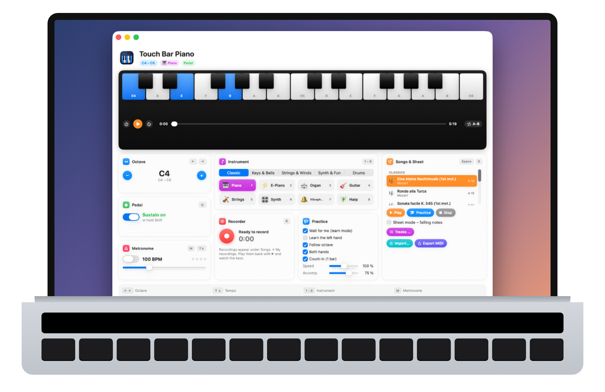
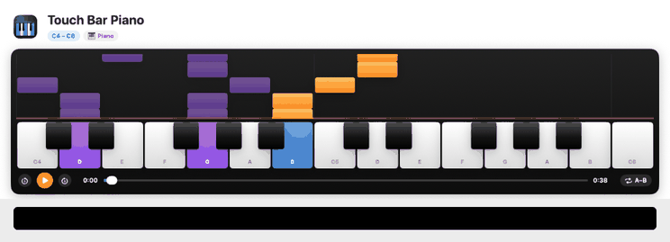
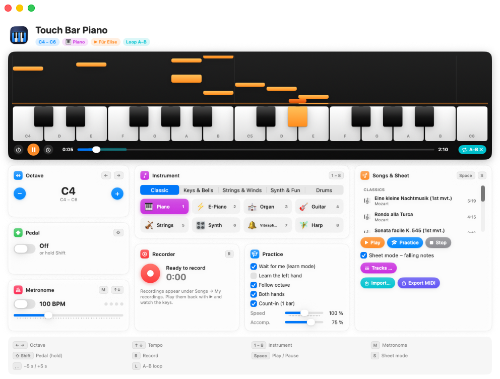
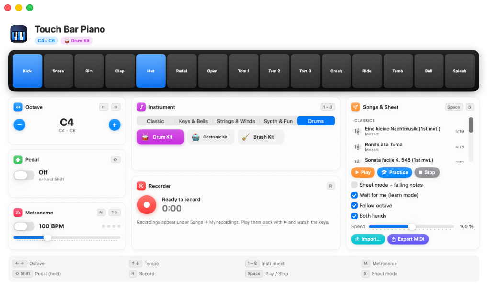
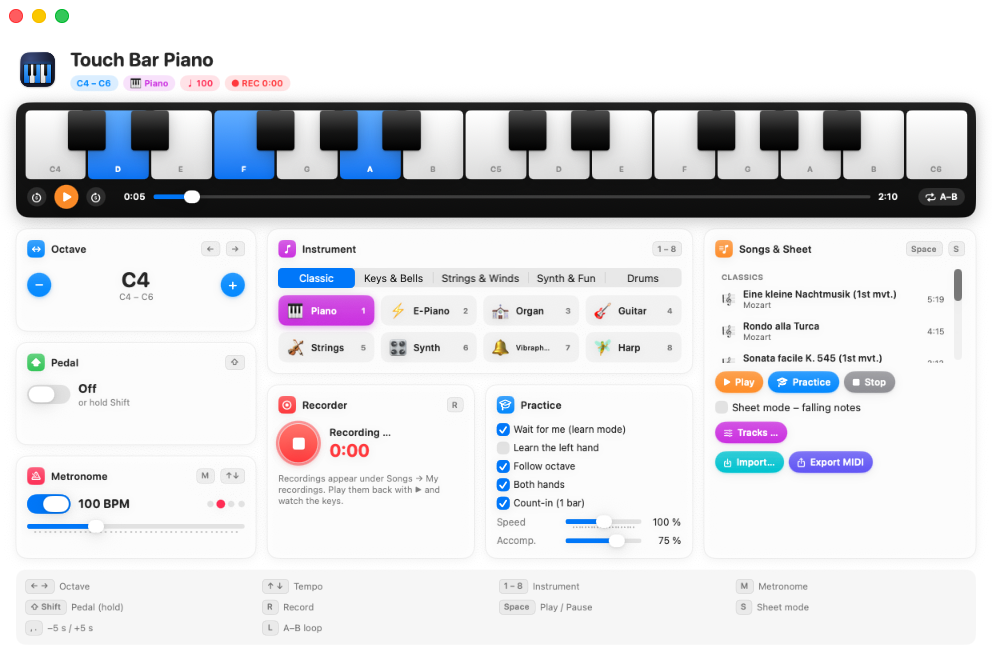

<p align="center"></p>

<h1 align="center">Touch Bar Piano</h1>

<p align="center">
  Turn your MacBook Pro's Touch Bar into a full-width piano – with 32 instruments,<br>
  a recorder, classical songs and a learn mode with falling notes.
</p>

<p align="center">
  <a href="../../releases/latest"></a>
  
  
  <a href="../../releases"></a>
  <a href="LICENSE"></a>
</p>

<p align="center"><a href="../../releases/latest/download/Piano.app.zip"><b>⬇︎ Download Piano.app</b></a></p>

<p align="center"></p>

<p align="center"></p>

> Window and Touch Bar images are real renders of the app, captured automatically on a GitHub macOS runner. Only the MacBook around them is an illustration.

## ✨ Features

| | |
|---|---|
| 🎹 **Full-width Touch Bar** | Two octaves with note names, multitouch chords, slide to glide. Esc and Control Strip are hidden. |
| 🎻 **32 instruments** | Piano, organ, strings, choir, sax, music box, steel drums … from the built-in macOS sound bank. |
| 🥁 **Drum mode** | 15 labelled pads (kick, snare, hats, toms, cymbals …) and 3 drum kits. |
| 🦶 **Sustain pedal** | Hold <kbd>Shift</kbd> – just like the pedal on a real piano. |
| ⏱ **Metronome** | 40–240 BPM with an accented first beat. |
| ⏺ **Recorder** | Record, play back and watch the keys light up. Recordings are kept between launches. |
| 🎼 **Classics built in** | Complete pieces by Mozart, Beethoven, Bach and Brahms with both hands – press play and watch. |
| 📖 **Sheet mode** | Falling notes show what to play next. *Learn mode* waits until you hit the right key. |
| 🎛 **MIDI** | Import `.mid` files and choose per track: melody, accompaniment or muted. Export your recordings to GarageBand & co. |
| ⏯ **Transport** | Pause, jump ±5 s, drag the progress bar, repeat a passage with an **A–B loop**. |
| 🙌 **Practice tools** | Learn the left hand, count-in, accompaniment volume, hands in different colours (melody blue, accompaniment purple). |
| 🌍 **English & German** | Follows your macOS language. |

## 🚀 Quick start

1. **[Download `Piano.app.zip`](../../releases/latest/download/Piano.app.zip)** and unzip it.
2. The app is not signed by Apple, so allow it once in Terminal:
   ```sh
   xattr -dr com.apple.quarantine Piano.app
   open Piano.app
   ```
3. Play! Everything works with the mouse, the keyboard shortcuts or the Touch Bar.

## 📸 Screenshots

| Learn mode – falling notes | Drum mode | Recording |
|---|---|---|
|  |  |  |


## ⌨️ Keyboard shortcuts

| Key | Action |
|---|---|
| <kbd>←</kbd> <kbd>→</kbd> | Octave down / up |
| <kbd>⇧ Shift</kbd> (hold) | Sustain pedal |
| <kbd>1</kbd> – <kbd>8</kbd> | Classic instruments |
| <kbd>M</kbd> | Metronome on / off |
| <kbd>↑</kbd> <kbd>↓</kbd> | Tempo ±5 BPM |
| <kbd>R</kbd> | Start / stop recording |
| <kbd>Space</kbd> | Play / pause the selected song |
| <kbd>,</kbd> <kbd>.</kbd> | Jump 5 s back / forward |
| <kbd>L</kbd> | A–B loop: set start, set end, clear |
| <kbd>S</kbd> | Sheet mode on / off |

Every shortcut is also shown – and clickable – in the app window.

## 🎻 Instruments

| Group | Instruments |
|---|---|
| Classic | Piano, E-Piano, Organ, Guitar, Strings, Synth, Vibraphone, Harp |
| Keys & Bells | Harpsichord, Celesta, Glockenspiel, Music Box, Marimba, Xylophone, Accordion |
| Strings & Winds | Violin, Cello, Pizzicato, Choir, Trumpet, Saxophone, Flute, Pan Flute |
| Synth & Fun | Synth Pad, Synth Bass, Steel Drums, Ocarina, Harmonica, Contrabass |
| Drums | Drum Kit, Electronic Kit, Brush Kit |

## 🎼 Built-in songs

Complete pieces with **both hands**, taken note for note from verified public-domain editions – see [`Songs/SOURCES.md`](Songs/SOURCES.md).

| Composer | Songs |
|---|---|
| Mozart | Eine kleine Nachtmusik (1st mvt.) · Rondo alla Turca · Sonata facile K. 545 (1st mvt.) · Ah vous dirai-je, Maman (Theme & Var. 1) |
| Beethoven | Für Elise · Ode to Joy |
| Bach / Petzold | Minuet in G |
| Brahms | Lullaby (Wiegenlied) Op. 49 No. 4 |

- **Both hands** (toggle): play back melody + accompaniment, or the melody alone. In play-along practice the left hand plays with you.
- **Follow octave** (toggle): the Touch Bar's two octaves move along with the melody, so whole pieces fit.
- Sheet and learn mode always use the melody (right hand) – the accompaniment shows as grey notes.

## ✍️ Write your own songs

Songs are plain text files – import them with **Import…** (see [`docs/example-song.txt`](docs/example-song.txt)):

```text
# title: Frère Jacques
# composer: Traditional
# bpm: 120
C4 D4 E4 C4 | C4 D4 E4 C4 | E4 F4 G4:2 | E4 F4 G4:2
```

| Syntax | Meaning |
|---|---|
| `C4`, `F#5`, `Bb3` | Note (`H` works as German B) – one beat |
| `E4:0.5`, `G4:2` | Note with length in beats |
| `C4+E4+G4` | Chord |
| `R`, `R:2` | Rest |
| `\|` | Bar line (ignored, just for reading) |

Standard **MIDI files** (`.mid`) work too. After importing, the **Tracks** dialog shows every track (or every channel for single-track files) with its instrument, note count and range – choose *Melody*, *Accompaniment* or *Muted* for each. The app suggests a split automatically (highest part = melody) and can keep only the top voice of the melody so you play one note at a time. Pull requests with new songs are welcome!

## 💻 Compatibility

Every Mac with a Touch Bar running **macOS 11 Big Sur or later**:

- MacBook Pro 13" (2016–2020, M1 2020, M2 2022)
- MacBook Pro 15" (2016–2019)
- MacBook Pro 16" (2019)

## ❓ FAQ

<details><summary><b>“Piano.app can't be opened because Apple cannot check it”</b></summary>

The app is open source but not notarized by Apple. Run `xattr -dr com.apple.quarantine Piano.app` once, or right-click the app → **Open**.
</details>

<details><summary><b>The Touch Bar doesn't show the piano</b></summary>

Quit other Touch Bar tools (BetterTouchTool, Pock, MTMR) and start the app again. If needed, set **System Settings → Keyboard → Touch Bar shows → App Controls**.
</details>

<details><summary><b>I hear no sound</b></summary>

Check the volume and the output device. The app uses the General MIDI sound bank that ships with macOS – nothing to install.
</details>

<details><summary><b>Does the piano stay on the Touch Bar when I switch apps?</b></summary>

Yes – it uses the same private macOS API as Pock and MTMR. Close the window or press <kbd>⌘Q</kbd> to give the Touch Bar back. Keyboard shortcuts only work while the window is active.
</details>

<details><summary><b>Where are my recordings stored?</b></summary>

In `~/Library/Application Support/Touch Bar Piano/songs.json`. Delete a song by hovering it in the list and clicking the trash icon.
</details>

## 🛠 How it works

| Part | Technology |
|---|---|
| Touch Bar | `NSTouchBar` + custom `NSView` with direct touches; system-wide via private `presentSystemModalTouchBar` |
| Sound | `AVAudioEngine` + 3× `AVAudioUnitSampler` with macOS' `gs_instruments.dls` |
| Pedal | MIDI Control Change 64 |
| Window | SwiftUI in an `NSWindow` |
| Songs | Bundled two-track MIDI files (melody + accompaniment) built by `tools/make_songs.py`; own text format + minimal MIDI reader/writer |
| CI | GitHub Actions builds, self-tests (songs + MIDI round-trip), renders screenshots and releases |

```
Sources/
├── main.swift      App start, keyboard shortcuts, CI snapshots
├── Model.swift     State, instruments, recorder, playback, learn mode
├── Audio.swift     Samplers
├── TouchBar.swift  Touch Bar view + private API
├── UI.swift        SwiftUI window
└── Songs.swift     Built-in songs, text format, MIDI
```

## 🔨 Build from source

```sh
./build.sh      # needs Xcode Command Line Tools
open Piano.app
```

**Release a new version:** change `VERSION` (e.g. `v4`), commit and push to `main` – the workflow builds, tests and publishes the release.

## 📄 License

[MIT](LICENSE) © touchbar-piano contributors · Song files: see [`Songs/SOURCES.md`](Songs/SOURCES.md) (public domain, *Sonata facile* CC BY-SA 3.0) · See the [CHANGELOG](CHANGELOG.md) for all versions.
